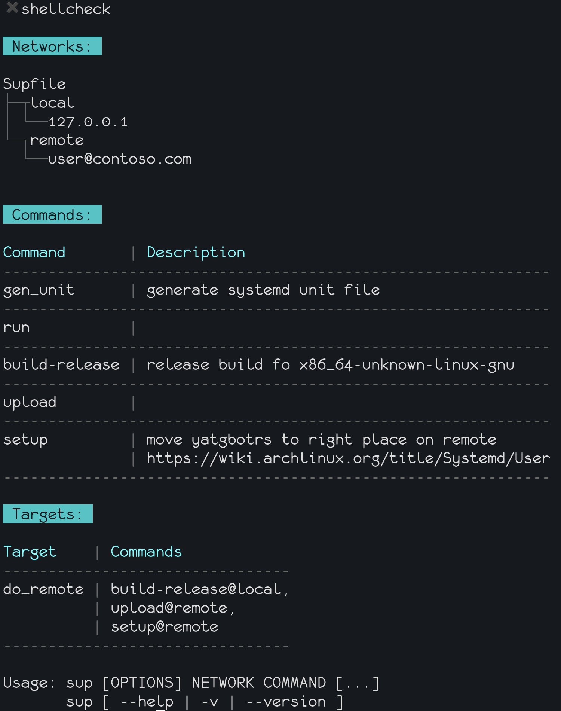

Note
========

This a rewrite of https://github.com/pressly/sup in a more "clean arch" fashion so i could understand whats going on and tinker it to my taste.  
Over time, it diverged from original in many ways.  

exact commit that was forked:  
- https://github.com/pressly/sup/commit/17c751e8ca547e2ef7fb5b6b2017543cd7172a05  
to be more specific.

this repo is mostly that code, re-arranged based on the ideas from:  
https://www.youtube.com/watch?v=C7MRkqP5NRI  
hense the name change, to keep projects visually different.  

Super Stack Up
========

Super Stack Up is a super simple deployment tool that performs given set of commands on multiple hosts in parallel.  
It reads Supfile, a YAML configuration file, which defines networks (groups of hosts), commands and targets.  

Intended usage
=========

Countless rewrites of makefile exist right now, this one was intended to gradually evolve with project development.  
The idea is to start small, usually, just a simple `build:` task and nothing else.  
When no networks defined in Supfile, program defaults to [Makefile mode](docs/mods/makefile.md), and you just run:

```sh
ssup build
```

to get your build ready. As expected, everything will happen locally,  
no need to specify network as part of the arguments, as in original sup.  

Over time, you may wish to build your code on a remote machine,  
all you have to do is to add a host  to [networks:](docs/base/network.md) section  
(well, network could consist of a single host, why not?), and specify  
network and command, as per original sup implementation:

```sh
ssup remote build
```

Now, when you are happily building your code locally and remotely, you may have a little  
remote host you wish to deploy your app to. It's trivial to add a task to dl the built app  
to your machine back, along with a new network pointing to your little remote host you wish  
to deploy to and a copule of tasks to copy the app there and launch it.  
It's bearable to use long form, with host and task for a few first times, while you're  
polishing your process of building and deploying, but it would be nice and KISS to actually type less  
to achieve the same results.  
Original sup has [targets:] to do just that, run a bunch of commands grouped to a single invocation,  
but you still have to specify a network as an argument, but i'm too lazy to do that every time.
Here a mod comes into play, in ssup, when defining [targets:]  
you can bind a certain command to the network you need.

```yml
targets:
  do_release:
  - build-release local
  - upload remote
  - setup remote
```

So the whole invocation shortens to:

```sh
ssup do_remote
```

And this is not the end of the story, now, when your project is building and you have your automation needs sorted,  
you may switch to doing smth else for a couple of month or so...  
Over time, when you re-visit to update your project to a new version, you may forget, should you run the `build` command  
or `do_release` command/target (i certainly do), so ssup adds a `desc:` field for a command for that.  
If you define a description via the `desc:` and run ssup without any arguments it will  
print a summary of your Supfile along with the correspondig descriptions (those could be mutiline).

```sh
# look ma, no args
ssup
```

will give you this:  


If you're like me, and you don't want to remember which command you use to build your code,  
you may as well wish not to know how to write a Supfile too (i surely do),  
so you have an `-x` flag for that, which you dont have to memorize too, as it'll be printed as part `-h` flag  
and `-h` is muscle memory, so it doesn't count for cognitive load.


# Demo

[](https://asciinema.org/a/19742?autoplay=1)

*Note: Demo is based on [this example Supfile](./example/Supfile).*

# Installation

```sh
$ go get -u github.com/momo182/ssup/cmd/ssup
```

# Usage

```sh
$ ssup [OPTIONS] NETWORK COMMAND [...]
```

### Options

| Option             | Description                            |
| ------------------ | -------------------------------------- |
| `-f Supfile`       | Custom path to Supfile                 |
| `-e`, `--env=[]`   | Set environment variables              |
| `--only REGEXP`    | Filter hosts matching regexp           |
| `--except REGEXP`  | Filter out hosts matching regexp       |
| `--debug`, `-D`    | Enable debug/verbose mode              |
| `--no-color`, `-c` | Disable colors                         |
| `--disable-prefix` | Disable hostname prefix                |
| `--help`, `-h`     | Show help/usage                        |
| `--version`, `-v`  | Print version                          |
| `-x`               | Print example Supfile to stdout        |
| `-z`               | Continue execution if one host failed  |
| `-t`               | Test connections                       |

- [Networks](docs/base/network.md)
- [Commands](docs/base/commands.md)
    - [Makefile mode](docs/mods/makefile.md)
- [Targets](docs/base/targets.md)


# Supfile

See [example Supfile](./example/Supfile).

### Basic structure

```yaml
# Supfile
---
version: 0.5
desc: supfile description goes here...
# Global environment variables
env:
  NAME: $(echo "api") # could be any command, really
  IMAGE: example/foobar:latest

networks:
  local:
    hosts:
      - localhost
  staging:
    hosts:
      - stg1.example.com
  production:
    hosts:
      - api1.example.com
      - api2.example.com

commands:
  echo:
    desc: Print some env vars
    sudo: true
    run: echo $NAME $IMAGE $SUP_NETWORK
  date:
    desc: Print OS name and current date/time
    # this will override $NAME from global level
    env:
        NAME: api_v2
    run: |
        uname -a; date
        echo $NAME

targets:
  all:
    - echo
    - date
```

Extensions to original sup
=========

- added support for `sudo: true` on task level
- added support for SSH password auth
- added support for short and long form network definitions
- env vars can use subshell syntax to grab a value by running a script
- password fields can use subshell syntax to run a script/commands to grab a value and use plain text value
- added automatic [shellcheck support](docs/mods/shellcheck_shebang.md) if you have it in PATH
- added [./dist folder support](docs/mods/dist_folder.md)
- [shebang at the first line](docs/mods/shellcheck_shebang.md) of `run:` and `local:` is respected
- added `#include://` directive for `run:` and `local:`
- ssup now changes dir to Supfile location to accomodate use of relative links with `#source://`
- skip all networks definitions to use implicit localhost mode (makefile mode)
- [namespaces to collect vars from one stage and pass those to next stages](docs/mods/namespaces.md)
- [added env vars templating to description fields and download dest field](docs/mods/env_vars_templating.md)
- added -x flag to print example Supfile.yml
- added -z flag to proceed execution even if some hosts unreachable
- added -t flag to test connections with creds setup in Supfile

### Default environment variables available in Supfile

- `$SUP_HOST` - Current host.
- `$SUP_NETWORK` - Current network.
- `$SUP_USER` - User who invoked sup command.
- `$SUP_TIME` - Date/time of sup command invocation.
- `$SUP_ENV` - Environment variables provided on sup command invocation. You can pass `$SUP_ENV` to another `ssup` or `docker` commands in your Supfile.


# Running sup from Supfile

Supfile doesn't let you import another Supfile. Instead, it lets you run `ssup` sub-process from inside your Supfile. This is how you can structure larger projects:

```
./Supfile
./database/Supfile
./services/scheduler/Supfile
```

Top-level Supfile calls `ssup` with Supfiles from sub-projects:

```yaml
 restart-scheduler:
    desc: Restart scheduler
    local: >
      ssup -f ./services/scheduler/Supfile $SUP_ENV $SUP_NETWORK restart
 db-up:
    desc: Migrate database
    local: >
      ssup -f ./database/Supfile $SUP_ENV $SUP_NETWORK up
```

The `$SUP_ENV` will be expanded to a series of -e invocations, this way  
envs from parent Supfile will be passed to child Supfile calls.

The `$SUP_NETWORK` is self-explanatory...

# Common SSH Problem

if for some reason sup doesn't connect and you get the following error,

```bash
connecting to clients failed: connecting to remote host failed: Connect("myserver@xxx.xxx.xxx.xxx"): ssh: handshake failed: ssh: unable to authenticate, attempted methods [none publickey], no supported methods remain
```

it means that your `ssh-agent` dosen't have access to your public and private keys. in order to fix this issue, follow the below instructions:

- run the following command and make sure you have a key register with `ssh-agent`

```bash
ssh-add -l
```

if you see something like `The agent has no identities.` it means that you need to manually add your key to `ssh-agent`.
in order to do that, run the following command

```bash
ssh-add ~/.ssh/id_rsa
```

you should now be able to use sup with your ssh key.


# Development

```sh
#fork it, hack it..

pipelight run build --attach -vvv

# create new Pull Request
```

We'll be happy to review & accept new Pull Requests!

# License

Licensed under the [MIT License](./LICENSE).
